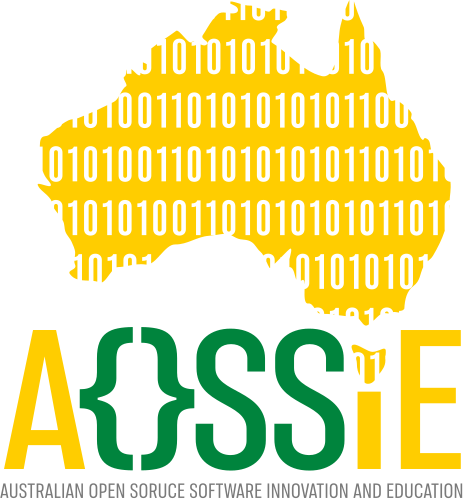
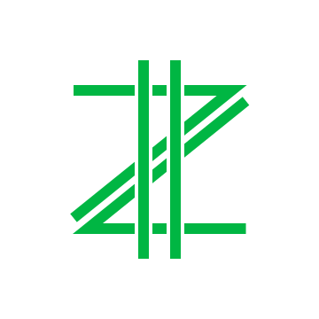

<!-- Don't delete it -->
<div id="readme-top"></div>

<!-- Organization Logo -->
<p align="center">
  
  &nbsp;&nbsp;
  
</p>

<p align="center">
  <a href="https://aossie.org">
    
  </a>
</p>

<!-- Organization/Project Social Handles -->
<p align="center">
  <a href="https://t.me/StabilityNexus">
    
  </a>
  &nbsp;
  <a href="https://x.com/aossie_org">
    
  </a>
  &nbsp;
  <a href="https://discord.gg/hjUhu33uAn">
    
  </a>
  &nbsp;
  <a href="https://discord.gg/YzDKeEfWtS">
    
  </a>
  &nbsp;
  <a href="https://www.linkedin.com/company/aossie/">
    
  </a>
  &nbsp;
  <a href="https://www.youtube.com/@AOSSIE-Org">
    
  </a>
  &nbsp;
  <a href="https://www.youtube.com/@StabilityNexus">
    
  </a>
</p>

<p align="center">
  <a href="https://github.com/AOSSIE-Org/Zplit-Website/actions/workflows/ci.yml"></a>
  <a href="https://github.com/AOSSIE-Org/Zplit-Website/actions/workflows/nextjs.yml"></a>
  <a href="https://scorecard.dev/viewer/?uri=github.com/AOSSIE-Org/Zplit-Website"></a>
</p>


---

<div align="center">
<h1>Zplit</h1>
</div>

Zplit is an open-source mobile application designed to simplify group expense management through a decentralized architecture. Zplit's core features are expense tracking, group management, and debt calculation, while prioritizing user data privacy, offline functionality, and peer-to-peer synchronization.

📱 **Get the app:** [Zplit on Google Play](https://play.google.com/store/apps/details?id=org.aossie.zplit) · 🧑‍💻 **App source:** [AOSSIE-Org/Zplit](https://github.com/AOSSIE-Org/Zplit)

This website is a high-performance, developer-friendly webpage built on **Next.js 16 (App Router)**, **React 19**, **Tailwind CSS v4**, and pre-configured for **Internationalization (i18n)** and **Localization (l10n)** using **next-intl**.

---

## 🚀 Project's Features

- **Decentralized Architecture**: Sync directly between devices using WiFi Direct, Bluetooth, NFC, and QR codes. No central servers required.
- **Privacy First**: All data is encrypted and stored locally on your device. You own your financial data completely.
- **Smart Expense Tracking**: Custom splits (equal, percentage, or custom amounts) with automatic debt calculation.
- **Receipt OCR**: Snap a photo of any receipt, and on-device machine learning automatically extracts the details.
- **Group Management**: Create groups for trips, flatmates and events with no accounts or sign-ups; invite via QR, NFC, Bluetooth or WiFi.
- **Offline-First**: Works fully offline; changes sync peer-to-peer when friends are nearby.
- **Visual Analytics**: Charts of group spending, category breakdowns and balances, with data export.

---

## 💻 Tech Stack

### Mobile App
- **Frontend**: Flutter
- **State Management**: Riverpod
- **Local Storage**: Hive / Drift
- **P2P Sync**: WiFi Direct, Bluetooth, NFC, and QR codes

### Web App (This Repository)
- **Framework**: Next.js 16 (App Router), React 19
- **Styling**: Tailwind CSS v4, CSS Variables
- **I18n / Localization**: next-intl
- **Theme**: next-themes
- **Animation & Scrolling**: Framer Motion, Lenis
- **Icons**: lucide-react (+ inline Simple Icons brand marks)

---

## 📋 Project Maturity Checklist

Status of the GSoC / AOSSIE project checklist for this website:

* [x] The project has a logo (`public/brand/icons/zplit_logo.svg`).
* [x] The project has a favicon (`public/brand/icons/favicon.ico`).
* [x] The web frontend:
   - [x] Has proper title and metadata.
   - [x] Has proper open graph metadata (1200x630 `public/og-image.png`), so it is shown well when shared in social media.
   - [x] Has a footer and header with AOSSIE logos and social handles.
   - [x] Uses React Server Components by default, introducing Client Components (`"use client"`) only when interactivity or client hooks are required.
   - [x] Is deployed to GitHub Pages via a GitHub Workflow (`.github/workflows/nextjs.yml`).
   - [x] Has automated CI lint, test (90% coverage gate) and build validation (`.github/workflows/ci.yml`).
   - [x] Has a `sitemap.xml` and a `robots.txt` that blocks `/pr-preview/`.
   - [x] Has OpenSSF Scorecard analysis (`.github/workflows/scorecard.yml`).
   - [x] Has CodeRabbit automated AI code review tailored to this project (`.coderabbit.yml`).
   - [x] Has open-source legal compliance (`DCO.md`, `COPYRIGHT.md`, `CONTRIBUTING.md`).

---

## 🧭 Landing Page Sections

| Section | Component | Highlights |
| :--- | :--- | :--- |
| Navbar | [`Navbar.tsx`](src/components/Navbar.tsx) | Glass effect that switches to a dark glass over the footer, logo scrolls to top, Contribute + Download (Play Store) CTAs |
| Hero | [`Hero.tsx`](src/components/Hero.tsx) | App mockup, USPs and credibility metrics |
| Features of Zplit | [`features/FeaturesShowcase.tsx`](src/components/features/FeaturesShowcase.tsx) | Scroll-driven pinned card (desktop) that highlights one feature at a time with animated, code-drawn app visuals ([`FeatureVisuals.tsx`](src/components/features/FeatureVisuals.tsx)); stacked cards on mobile |
| Checkout Innovation | [`InnovationSection.tsx`](src/components/InnovationSection.tsx) | Interactive Lego tech-stack builder ([`TechStackMiniGame.tsx`](src/components/TechStackMiniGame.tsx), default tab, touch-friendly swipe tray on mobile) and P2P methods |
| FAQs | [`FaqSection.tsx`](src/components/FaqSection.tsx) | Searchable, category-filtered accordion with `FAQPage` JSON-LD |
| Footer | [`footer/Footer.tsx`](src/components/footer/Footer.tsx) | Interactive P2P mesh canvas ([`MeshCanvas.tsx`](src/components/footer/MeshCanvas.tsx)), download CTAs, marquee, magnetic socials and a "splitting" wordmark |

All animations respect `prefers-reduced-motion`, off-screen animations are paused or unmounted, and every string lives in the `src/messages/*.json` catalogs.

---

## 🚀 Website's Features

- **Next.js 16 & React 19:** Utilizing the latest Server Components, Client Actions, and async routing paradigms.
- **Tailwind CSS v4:** Modern utility-first styling with native CSS variables and streamlined postcss integrations.
- **Dual Theme System:** Flash-free light, dark, and system-preferred themes using `next-themes` and Tailwind CSS v4 custom variants.
- **Robust i18n & l10n:** Deeply integrated multi-language support:
  - Automatic locale detection based on browser preferences.
  - Subpath routing (e.g., `/hi` for Hindi, and `/en` for English as default) with clean URL prefixing.
  - Sleek, interactive language switcher client component.
  - Zero-bundle-size footprint for static translations using Server Components & Client `useTranslations`.
- **Developer Experience:** Strict TypeScript compilation and ES Lint setup.
- **Application Control Compatibility:** Configured with manual Webpack & Turbopack alias resolution to bypass restrictive execution environments blocking native binary compiles.
- **Open-Source Governance & CI/CD:** Integrated GitHub Actions workflows (`ci.yml`, `nextjs.yml`, `label-merge-conflicts.yml`), `.coderabbit.yml`, and `DCO.md` legal documentation.
- **AI Agent Pairing Ready:** Includes `AGENTS.md` and `CLAUDE.md` to guide AI development agents.

---

## 📂 Project Structure

Here is a breakdown of the key i18n directories and files:

```text
├── .github/
│   └── workflows/          # GitHub Actions (CI, GitHub Pages deployment, merge conflict checks)
├── next.config.ts          # Alias-wrapped Next configuration
├── public/                 # Static assets, robots.txt, assetlinks.json, llms.txt
│   ├── .well-known/
│   ├── llms.txt
│   ├── robots.txt
│   └── brand/
│       ├── Brand.md            # Official AOSSIE brand guidelines document
│           ├── aossie_logo.svg              # AOSSIE Vector logo
│           ├── stability_nexus_logo.svg     # Stability Nexus Vector logo
│           ├── zplit_logo.svg               # Zplit Vector logo
│           └── favicon.ico                  # Browser tab icon
├── src/
│   ├── config/
│   │   ├── languages.ts        # Central registry of supported languages & locales
│   │   └── links.ts            # External links (Play Store, GitHub, Discord, socials)
│   ├── i18n/
│   │   ├── routing.ts          # Core i18n routing parameters (locales, defaults)
│   │   ├── request.ts          # Server-side translation dictionary loading configuration
│   │   ├── metadata.ts         # Configuration data, SEO values, or reflection data for a project
│   │   └── navigation.ts       # Type-safe navigation helpers (Link, useRouter, etc.)
│   ├── messages/
│   │   ├── en.json             # English translation dictionary
│   │   └── hi.json             # Hindi translation dictionary
│   ├── app/
│   │   ├── (root)/             # Bare `/`: full metadata + meta-refresh to /en (static export)
│   │   ├── sitemap.ts          # Statically generated localized sitemaps
│   │   └── [locale]/           # Localized route group
│   │       ├── layout.tsx      # Multi-lingual layout injecting client context & translations
│   │       ├── page.tsx        # Localized Landing Page ("use client")
│   │       ├── globals.css     # Global styles for the app segment
│   │       ├── error.tsx       # Localized Error Boundary page fallback
│   │       └── not-found.tsx   # Localized 404 page fallback
│   └── components/
│       ├── Navbar.tsx           # Sticky glass navigation bar
│       ├── Hero.tsx             # Hero section
│       ├── InnovationSection.tsx # Tech Stack / P2P methods tabs
│       ├── TechStackMiniGame.tsx # Interactive Lego tech stack builder
│       ├── FaqSection.tsx       # Searchable FAQ accordion
│       ├── features/
│       │   ├── FeaturesShowcase.tsx # Scroll-driven "Features of Zplit" card
│       │   └── FeatureVisuals.tsx   # Animated app illustrations for each feature
│       ├── footer/
│       │   ├── Footer.tsx       # Animated footer
│       │   └── MeshCanvas.tsx   # Interactive peer-to-peer mesh background
│       ├── icons/
│       │   └── BrandIcon.tsx    # GitHub / Discord / X / Telegram / LinkedIn / YouTube marks
│       ├── LanguageSwitcher.tsx # Dropdown element to switch interface locales interactively
│       ├── ThemeToggle.tsx      # Multi-state theme switch with micro-animations
│       └── providers/
│           ├── theme-provider.tsx # Next-themes client wrapper component
│           └── lenis-provider.tsx # Lenis smooth scrolling provider wrapper
├── .coderabbit.yml         # Automated AI Code Review configuration
├── COPYRIGHT.md            # Copyright terms
├── CONTRIBUTING.md         # Contribution guide
└── DCO.md                  # Developer Certificate of Origin
```

---

## 🛠️ Usage Guide

### 1. Adding a New Language

To add support for a new language (e.g., French - `fr`):

1. **Register the language:** Open [`src/config/languages.ts`](src/config/languages.ts) and add your new language to the `languages` array:
   ```typescript
   export const languages: Language[] = [
     { code: 'en', name: 'English', localName: 'English' },
     { code: 'hi', name: 'Hindi', localName: 'हिन्दी' },
     { code: 'fr', name: 'French', localName: 'Français' } // Add this line
   ];
   ```

2. **Create the translation catalog:** Under `src/messages/`, create a new file named `fr.json`:
   ```json
   {
     "Home": {
       "heading": "Bienvenue sur Zplit"
     }
   }
   ```

3. That's it! Next.js and `next-intl` will automatically register the locale, add it to the routing tables, and handle redirection for visitors matching `fr` browser preferences.

---

### 2. Translating Text in Pages and Components

#### Server Components (Recommended for Static Content)
By default, server components can load translations statically without shipping translation JSONs to the client bundle:

```tsx
import { useTranslations } from 'next-intl';

export default function Section() {
  const t = useTranslations('Home');
  return <h1>{t('heading')}</h1>;
}
```

#### Client Components
If your component uses React hooks (e.g., `useState`), define it with `"use client"` and import from `next-intl`:

```tsx
"use client";

import { useTranslations } from 'next-intl';

export default function InteractiveButton() {
  const t = useTranslations('Home');
  return <button onClick={() => alert('Clicked!')}>{t('heading')}</button>;
}
```

---

### 3. Navigation Helpers

When navigating between routes, always use the locale-aware navigation helpers imported from [`src/i18n/navigation.ts`](src/i18n/navigation.ts) instead of standard `next/link` or `next/navigation`:

```tsx
import { Link } from '../../i18n/navigation';

// Will automatically resolve to /en/about or /hi/about based on active locale
<Link href="/about">About Us</Link>
```

For programmatic router navigation:
```typescript
import { useRouter, usePathname } from '../../i18n/navigation';

const router = useRouter();
const pathname = usePathname();

// Switch active locale on current page
router.replace(pathname, { locale: 'hi' });
```

---

### 4. Theme Configuration & Dual Theme Support

The website uses `next-themes` combined with Tailwind CSS v4's class-based custom variants to provide a responsive and flash-free theme experience.

#### Customizing Colors

**Preferred Method**

Tailwind v4 is configured via CSS custom properties in [`src/app/[locale]/globals.css`](src/app/[locale]/globals.css). To adjust the default light and dark theme background or text colors, edit the root variables:

```css
:root {
  --background: #ffffff; /* Light theme background */
  --foreground: #121212; /* Light theme text */
}

.dark {
  --background: #0a0a0a; /* Dark theme background */
  --foreground: #f4f4f5; /* Dark theme text */
}
```

#### Section Tokens & Variants

Besides the base palette, `globals.css` defines tokens for the always-dark surfaces and a few helpers:

| Token / Variant | Purpose |
| :--- | :--- |
| `showcase-from`, `showcase-to`, `showcase-border`, `showcase-glow`, `showcase-stage` | "Features of Zplit" card surfaces (light & dark values) |
| `footer-bg`, `footer-surface`, `footer-border`, `footer-text`, `footer-muted` | Footer surfaces and text (light & dark values) |
| `accent-bright`, `accent-soft`, `aossie-gold` | Bright accents used on dark surfaces |
| `.nav-on-dark` | Re-maps navbar tokens while it floats over the footer |
| `tall:` variant | `@media (min-height: 860px)` – roomier spacing for pinned layouts |

#### Using Theme Classes
To create element styles that adapt automatically to the user's selected theme, use semantic utility tokens instead of inline `dark:` utilities:

```tsx
<div className="bg-background-secondary text-foreground-primary border border-border-default">
  This card automatically transitions colors across light and dark themes.
</div>
```

---

### 5. Smooth Scrolling (Lenis)

The website integrates the `lenis` library to provide smooth, high-performance inertial scrolling across all browsers.

#### Customizing Lenis Options
To configure scroll parameters (e.g., dampening velocity, custom scroll durations, or scroll directions), update the parameters passed to the `ReactLenis` component in [`lenis-provider.tsx`](src/components/providers/lenis-provider.tsx):

```tsx
<ReactLenis root options={{ lerp: 0.1, duration: 1.5, smoothWheel: true }}>
  {children}
</ReactLenis>
```

To access the active Lenis instance or bind custom scroll animations programmatically in your page components, use the `useLenis` hook:

```typescript
import { useLenis } from 'lenis/react';

const lenis = useLenis(({ scroll, limit, velocity, direction }) => {
  // Bind your scroll logic or animation timelines here
});
```

---

## ⚡ Development and Deployment

### Getting Started

Install the project dependencies:
```bash
npm install
```

Start the development server:
```bash
npm run dev
```

Open [http://localhost:3000](http://localhost:3000) to view it. The application will automatically detect your browser's language preferences and route you to `/hi` for Hindi or `/en` for English (the default locale).

### Building for Production (Static Export)

Compile and export the project into static HTML/CSS/JS assets for hosting on GitHub Pages:

```bash
npm run build
```

This generates an optimized static export in the `./out` directory, fully configured for client-side rendering and hosting on GitHub Pages. Preview it locally with `npx serve out`.

### Testing

```bash
npm test                # run the Vitest suite once
npm run test:watch      # re-run on file changes
npm run test:coverage   # with coverage; fails below 90% (same as CI)
```

Tests in [`tests/`](tests/) cover SEO metadata, the sitemap, site links and translation-catalog parity (keys, empty strings, ICU placeholders), including [fast-check](https://fast-check.dev) property tests.

---

## 🤝 Contributing

We welcome contributions of all kinds! To contribute:

1. Fork the repository and create your feature branch (`git checkout -b feature/AmazingFeature`).
2. Commit your changes (`git commit -m 'Add some AmazingFeature'`).
3. Ensure code quality (CI runs the same checks):
   - `npm run lint`
   - `npm run test:coverage`
   - `npm run build`
4. Sign off your commits (`git commit -s`), see [CONTRIBUTING.md](CONTRIBUTING.md).
5. Push your branch (`git push origin feature/AmazingFeature`).
6. Open a Pull Request and share it in the [#Zplit Discord channel](https://discord.com/channels/1022871757289422898/1438097765887643709).

© 2026 AOSSIE. Released under the Apache 2.0 / Open Source License.
